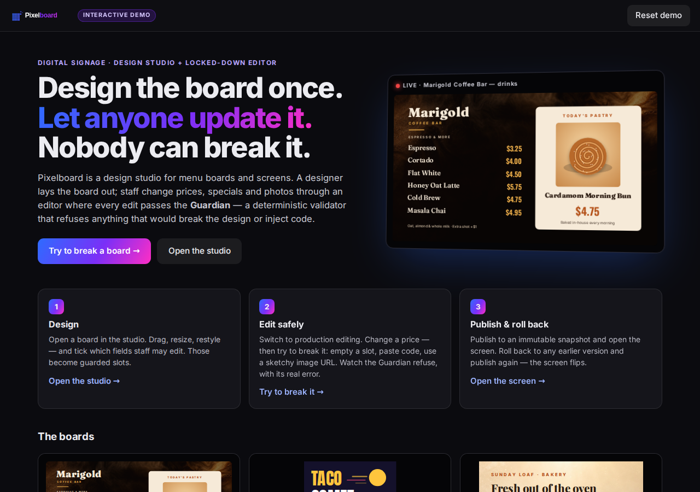
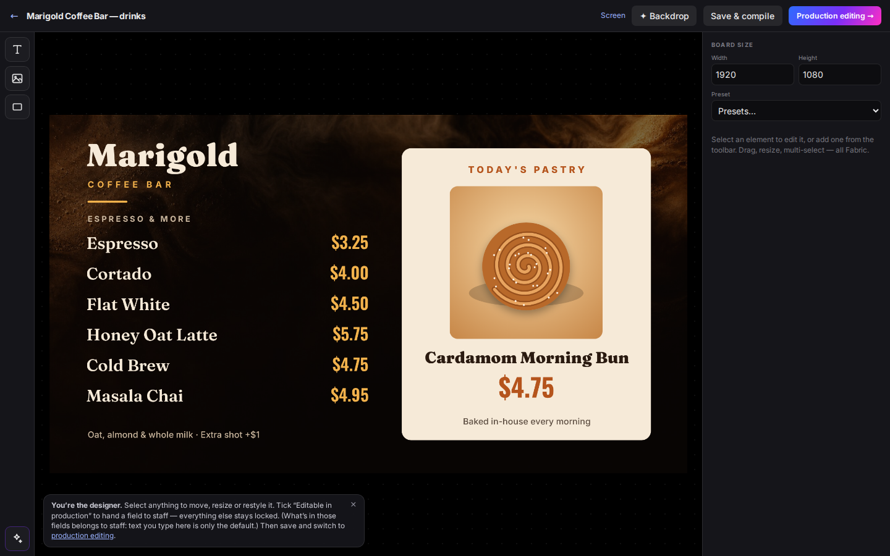
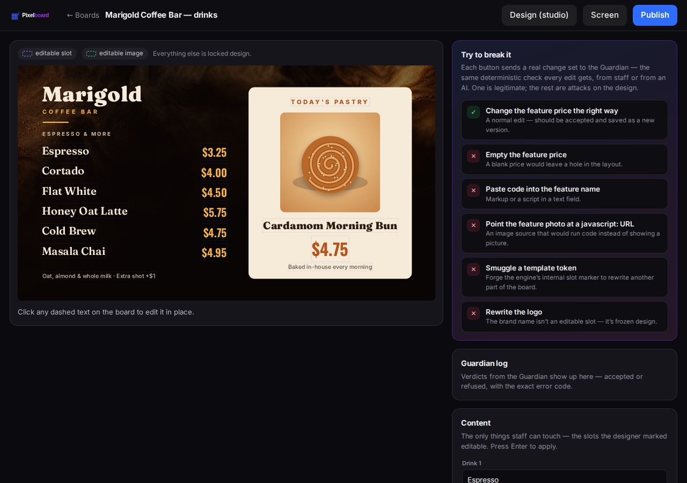
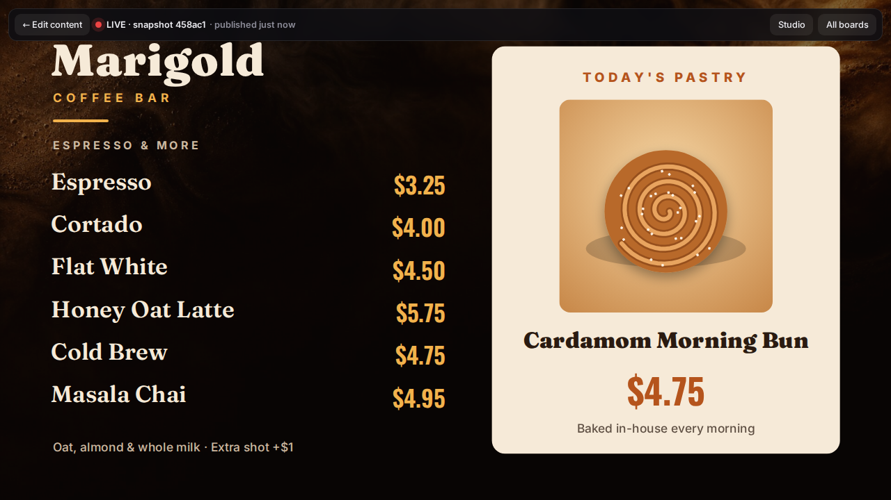
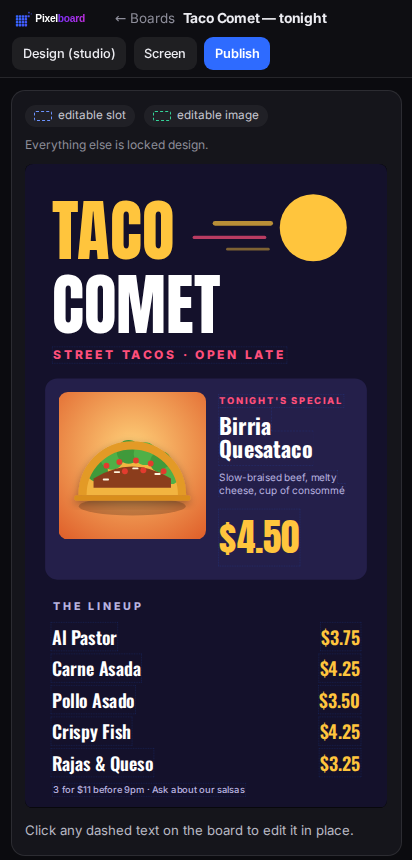

# Pixelboard

A Canva-style design editor for digital signage (menu boards, specials screens,
promo displays). A designer lays a board out once; staff then change only the
fields the designer unlocked (prices, specials, photos), and every edit passes
through a deterministic validator, the **Guardian**, so an untrained operator
cannot break the design or inject markup. A screen points at an immutable
published snapshot; publishing flips it, and any earlier version can be rolled
back to.



## Why

Signage tools tend to fail in one of two ways: a free-form editor that anyone
can break, or a locked form that a designer cannot touch. Pixelboard splits the
two jobs. The design surface is rich (Fabric.js canvas, AI generation). The
production surface is narrow and provably safe: the AI never writes templates
or code, it may only propose a map of slot changes, and those go through the
same Guardian as a human edit.

## Features

- **Design studio** (`/studio`): drag, resize, rotate and multi-select text,
  shapes and images on a Fabric.js canvas; board sizes 9:16, 16:9, 1:1, 21:9 or
  custom; tick which elements are editable in production.
- **The Guardian** (`src/guardian.js`): pure `(slots, changes) -> ok | errors`.
  Rejects unknown slots, emptied structural slots, markup in text, unsafe URLs
  and forged template tokens. No AI involved.
- **One render function** (`src/render.js`): the editor preview and the publish
  pipeline share it. Slot ids are structural, so they survive re-ingest.
- **Publish, snapshots, rollback**: screens play `/sites/:id/display` or a
  stable `/live` URL that flips on publish. Optional flat-image rasterisation
  for screens that cannot render HTML.
- **Phone-first operator editor**: labelled field list, draft-versus-on-screen
  status, one "Put on TV" action.
- **AI board generation** (optional): Anthropic or OpenRouter, constrained to a
  whitelisted board schema; curated fonts, templates and a backdrop library.
- **Ingest** existing HTML menus into frozen template + slots (SSRF-guarded
  URL fetch, scripts stripped), and convert them to studio boards (needs Chrome).
- **Storage**: filesystem by default; Supabase backend plus a Vercel serverless
  entry (`api/index.js`) for hosted use.
- **Static in-browser demo** (`src/demo`): the real engine and studio bundled
  with esbuild, running on fictional boards with no server.

| Studio | Operator editor and Guardian |
|---|---|
|  |  |
| **Live screen** | **Phone editor** |
|  |  |

## Run

Node 20 or newer.

```bash
npm install
cp .env.example .env.local     # optional: set a master key, session secret, AI key
npm run dev                    # http://127.0.0.1:3006
```

Open `/studio` to design a board, or ingest an HTML page with
`npm run ingest -- ./menu.html`. Without `VELLUM_MASTER_KEY` the dashboard is
open (development only). AI generation needs `ANTHROPIC_API_KEY` or
`OPENROUTER_API_KEY`; everything else works without one.

Build the static demo: `DEMO_OUT_DIR=/tmp/pixelboard-demo npm run build:demo`.
It assumes it is served under `/work/pixelboard/` (`BASE` in
`src/demo/build.mjs`); change that constant for another path.

## Test

```bash
npm test
```

Node's built-in runner, no network needed: 111 tests, 110 pass, 1 skipped
(the end-to-end PNG test needs a Chrome binary). Coverage includes the Guardian,
ingest, board schema and compiler, auth and client sessions, the editor field
model, storage and snapshots, SSRF guarding and the AI layer (mocked).

## Layout

```
src/guardian.js, render.js, ingest.js, ids.js   engine
src/board/                                      board schema + compiler
src/studio/                                     Fabric.js design surface
src/server.js, pages.js, editor_page.js         Express app and pages
src/storage*.js                                 filesystem and Supabase stores
src/ai.js                                       constrained AI generation
src/demo/                                       static in-browser demo
docs/adrs/                                      design decisions
```

Design decisions are written up in `docs/adrs/` (content model, auth, AI
editing, board model, gradients and curved text, flat-image rasterisation).

## Credits

The validator-guarded slot model comes from the "AI-Native Client CMS: Free
Build Blueprint" by AI Automations by Jack, by way of my earlier project
Vellum. See [THIRD-PARTY.md](THIRD-PARTY.md).

## Licence

Copyright (c) 2026 Aaron Neece. All rights reserved. Published for portfolio
review only; see `LICENSE`. Fonts and npm dependencies are third-party under
their own licences; see `THIRD-PARTY.md`.
